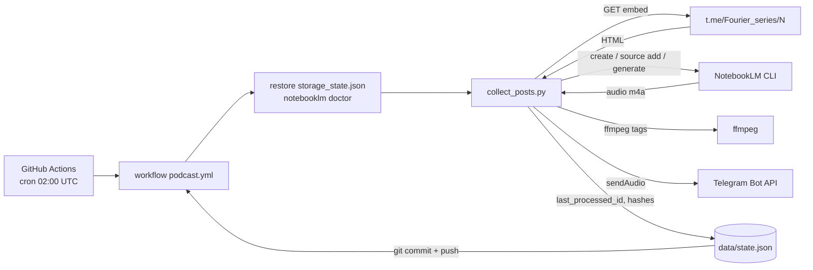

# notebooklm-podcast

Ежедневный пайплайн: берёт новый содержательный пост из Telegram-канала
«Ряды Фурье» (`@Fourier_series`), собирает из него подкаст в NotebookLM и
отправляет аудио в Telegram-группу.

## 1. Бизнес-требования

- **Зачем**: автоматически превращать текстовые научно-популярные посты канала
  в короткие аудиоподкасты, чтобы подписчики слушали контент в дороге.
- **Для кого**: подписчики канала и чата «Ряды Фурье».
- **Задача**: раз в сутки, без участия человека, публиковать один новый подкаст
  по самому свежему ещё не озвученному посту.
- **Критерии успеха**: в Telegram-группе ежедневно появляется аудио,
  соответствующее новому посту; повторов и пропусков нет.
- **Ограничения**: всё крутится на GitHub Actions (бесплатные минуты), один
  подкаст за прогон, NotebookLM требует валидной сессии (cookies).

## 2. Технические требования

- **Вход**: HTML-embed поста `https://t.me/<channel>/<id>?embed=1&mode=tme`,
  конфиг `config.json`, состояние `data/state.json`, секреты
  `NOTEBOOKLM_STORAGE_STATE`, `TELEGRAM_BOT_TOKEN`.
- **Отбор поста**: текст не пустой, длина ≥ 200 символов, не приветственный
  пост канала, хеш нормализованного текста не встречался ранее.
- **Генерация**: `notebooklm create` → `source add` → `generate audio`
  (ru, deep-dive, short) → `download audio` → `ffmpeg` (теги) → `sendAudio`.
- **Выход**: m4a в Telegram-группу `TELEGRAM_CHAT_ID`, тред
  `TELEGRAM_THREAD_ID`; обновлённый `data/state.json` коммитится в репозиторий.
- **Расписание**: cron `0 2 * * *` (05:00 МСК) + ручной запуск
  `workflow_dispatch`.
- **Надёжность**: state обновляется только после успешной отправки; ошибка
  HTTP при получении поста валит прогон, чтобы не потерять посты.

## 3. Архитектура

- `collect_posts.py` — весь пайплайн: отбор поста, генерация, отправка, state.
- `.github/workflows/podcast.yml` — ежедневный запуск, восстановление сессии,
  установка ffmpeg, коммит state.
- `.github/workflows/test.yml` — ручная проверка скачивания аудио.
- `data/state.json` — `last_processed_id`, `last_run`, `processed_text_hashes`.
- `config.json` — список каналов (сейчас один: `Fourier_series`).
- `posts.json` — локальный дамп постов, пайплайном не используется.

## 4. Лог решений

### 2026-11-19 — Указатель сдвигается на любом пропущенном посте

- **Контекст**: с 09.11.2026 подкасты перестали генерироваться. Прогоны
  завершались успешно, но всегда проверяли посты 952–957 и печатали
  «No new posts». Посты 952–961 — короткие (< 200 символов), отбрасываются
  `is_content_post()`, а `last_processed_id` двигался только при отправке
  подкаста или пропуске дубля по хешу. Окно поиска (6 постов) целиком
  заполнилось отбракованными постами → вечное застревание, 59 контентных
  постов (962–1030) не обрабатывались.
- **Решение**: `last_skipped_id` обновляется для любого пропущенного поста;
  окно поиска увеличено до `SEARCH_WINDOW = 30`; HTTP-ошибка при получении
  поста теперь исключение, а не «поста нет».
- **Альтернативы**: сдвигать окно на `last_id` без ограничения (лишние
  запросы и риск упереться в лимиты t.me); обрабатывать несколько постов
  за прогон (отложено — выбран минимальный фикс); хранить только
  `last_processed_id` без хешей (не решает проблему).
- **Последствия**: застревание устранено, но бэклог 962–1030 (~59 постов)
  будет разбираться по одному подкасту в день, пока не рассосётся.
  Один прогон делает до 30 HTTP-запросов к t.me.
